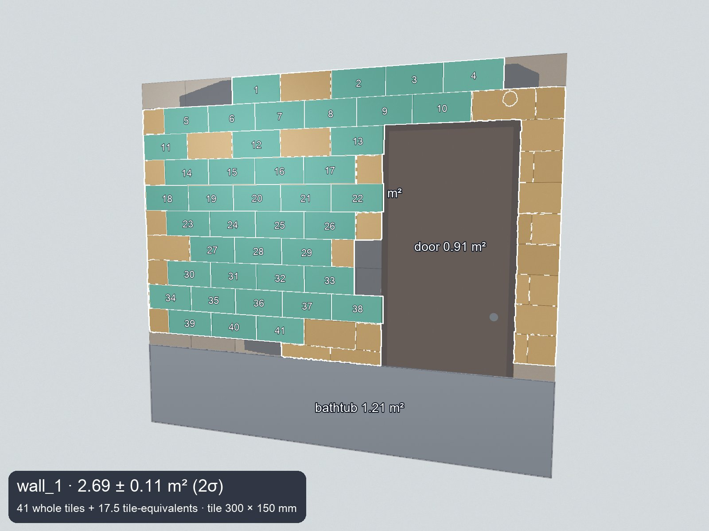

# ActCheck

**Check a renovation bill against photos of the finished work, before you pay.**

Families pay contractors from a work statement: "Wall tiling, 6.2 m² × 9,500 KZT". Most cannot verify that number, and a tape measure does not settle the argument. ActCheck reads the statement, measures the tiled walls from ordinary phone photos, and returns line-by-line findings with uncertainty and polite questions for the contractor.

Tile is laid on a regular grid and its size is printed on the box, so **the room is its own ruler**. SAM 3.1 finds the tiles, and their lattice recovers the wall plane and its scale without a reference object or a depth sensor.

Problem statement: **Build for Your World**.



*Synthetic demo wall: teal tiles matched the lattice, the caption gives the area ± 2σ.*

## Worked example

The bundled example uses a synthetic statement with planted errors and a synthetic wall. It runs the real agent on a stored SAM measurement.

| Line | Billed | Measured | Finding |
| --- | --- | --- | --- |
| Removing old tile | 4.5 m² | not measurable | Asks for photos taken before the work |
| Waterproofing | 3 m² | not measurable | Hidden work: asks for photos or a hidden-works record |
| Wall tiling | 6.2 m² | 2.69 m² | **Over-billed** |
| Grouting | 6.2 m² | 2.69 m² | **Over-billed**; also 6.2 × 800 = 4,960, but the statement says 5,960 |
| Faucet installation | 1 pcs | not measurable | Not checked by photo |

Result: the camera checked 70% of the statement's amount and found at least 20,991 KZT to clarify. That figure is the lower bound of the difference, for a conversation with the contractor, not a verdict.

## How Meta's models are used

| Model | Job | Why it matters |
| --- | --- | --- |
| **SAM 3.1** (Meta Model API) | Segments every tile on the full frame and nine overlapping crops; also finds doors, windows, mirrors, bathtubs and the floor; counts objects such as sockets | SAM is used as a **measuring instrument**. Tile masks become a homography from image to wall plane, in millimetres |
| **Muse Spark 1.3** (Meta Model API) | Reads photos and PDFs of statements in Russian and Kazakh into structured lines | Handles varied layouts and phone-style photos |

Models read and segment; ordinary code decides. Arithmetic, geometry, comparison and every verdict are deterministic, so a result can be traced and reproduced.

## How it works

1. **Parse** the statement with Muse Spark ([`agent/act_parser.py`](agent/act_parser.py)) and audit its arithmetic in code.
2. **Plan** which lines a camera can verify ([`agent/planner.py`](agent/planner.py)). Hidden work is never guessed: it becomes a question.
3. **Measure** each wall ([`measure/`](measure/README.md)): tile masks → lattice-constrained homography → area in m² with random and systematic uncertainty, exclusions, and an overlay a person can check.
4. **Compare** conservatively ([`agent/compare.py`](agent/compare.py)): a line is over-billed only if `billed > measured + 2σ + hidden area`. A wall that is not fully measured gives "needs more evidence", never an accusation.
5. **Write the protocol** in Russian, Kazakh or English ([`agent/protocol.py`](agent/protocol.py)), with an explanation and a question per line.

A wall is reported as `measured`, `partial` or `unavailable`, and the warnings say how to retake the photo.

## Results so far

Each check is labelled by what it can show. Details and commands: [`validation/README.md`](validation/README.md).

| Check | Data | Result |
| --- | --- | --- |
| Area on synthetic walls, through real SAM 3.1 | 16 renders with exact truth | 11 reported `measured`: median error 0.89%, max 2.44%, all within 2σ. The other 5 were flagged or refused |
| Area with simulated masks | 40 renders | 34 `measured`: median error 0.63%, max 4.4%, all within 2σ |
| Over-billing rule, simulated masks | Planted inflation of 0–30% | 0% false alarms; 92% of inflations of 20% or more caught |
| Over-billing rule, SAM 3.1 renders | Planted inflation of 0–30% | 1 false alarm in 15 honest bills, from a synthetic bathtub band SAM did not recognise |
| Statement parsing | 5 synthetic statements, including Kazakh and a phone-style photo | Every checked field matched; 2 of 2 planted errors found, no false ones |
| Reference web photos | 20 photos with no physical scale | No area claimed: 14 `partial`, 6 refused. Shows behaviour only |

**Field accuracy has not been established.** No wall has been compared with a laser or tape measurement yet ([protocol](validation/FIELD_PROTOCOL.md)). Bills in the over-billing checks are planted, not observed contractor statements.

## Known limits

- **The tile size drives every area.** A wrong size gives a wrong area. The form requires it and asks about likely centimetre typos, but cannot verify it.
- **Walls must fit in the frame.** In most real interior photos we tried, the tile continues past the edge, so the wall is `partial` and the line needs more evidence.
- **Other surfaces can be counted.** On one real photo, a blue panel and a column of different tiles were counted as area. This raises the measurement, which favours the contractor, but the number is wrong.
- **Hard surfaces:** small mosaics, narrow stripes, curved walls and low-contrast tile are often refused.
- **Only wall tiling is measured.** Painting, plumbing and hidden work are out of scope and become questions.

## Try it

**Hosted:** https://actcheck-production.up.railway.app opens the worked example, which makes no model calls.

**Live analysis does not currently work on the hosted version.** From the cloud servers we tried (Railway and Render, in the US, Europe and Asia), the Meta Model API returns an empty model list and 404, while the same key works from our laptop in Kazakhstan. We have not established why. To run an analysis, use your own key locally:

```sh
cp .env.example .env                                  # add META_API_KEY
docker build -t actcheck .
docker run --env-file .env -p 8000:8000 actcheck      # open http://localhost:8000
```

An uncached wall takes 30–60 s and about 15 SAM requests (around $0.04). Measure one wall without the UI:

```sh
uv sync --locked
uv run python -m measure.cli wall photo.jpg --tile 300x600 --source box_label
```

Run the tests with `uv run pytest` (offline, no model calls). Development setup: [`app/README.md`](app/README.md).

## Built during the hackathon

All of the code and data in this repository was committed during the event, and the commit history shows it.

**Timing we are disclosing.** The building period is listed as October 27 – November 4, and kickoff was October 26 at 12:00 ET. The first seven commits are dated October 26 between 13:12 and 15:38 ET, after kickoff: project setup, the model reference, the first draft of the schemas, act parser, arithmetic audit and comparison, and the first version of the frontend. Everything else came later.

**Not ours:** open-source dependencies listed in [`pyproject.toml`](pyproject.toml) and [`app/frontend/package.json`](app/frontend/package.json), including `meta-sam-parser`, OpenCV, FastAPI, React and Radix UI. AI coding assistants, including Claude Code, helped write the code.

**Data.** Demo statements and walls are synthetic. The example bathroom image is AI-generated ([provenance](app/frontend/ASSETS.md)). The 20 reference photos are from Pexels and are not committed; [`bathroom_tiles_20/sources.csv`](bathroom_tiles_20/sources.csv) lists their sources. Private photos and API keys stay out of the repository.

## Repository

| Path | Purpose |
| --- | --- |
| `agent/` | Statement parsing, arithmetic audit, planning, comparison, protocol |
| `measure/` | SAM client, lattice geometry, area and uncertainty, overlays, CLI |
| `validation/` | Synthetic evaluation, planted-inflation ROC, reference run, field protocol |
| `app/server/` | FastAPI: runs inspections, serves the UI |
| `app/frontend/` | React/Vite interface in English, Russian and Kazakh |
| `schemas/` | Shared Pydantic contract |
| `tests/` | Offline, deterministic tests |
| `data/samples/` | Synthetic public fixtures |
| `docs/` | Model access notes |

**Team:** Atilla Kenebay (measurement, validation, frontend) and Miras Auganbayev (agent, API, integration).

Licensed under [MIT](LICENSE).
